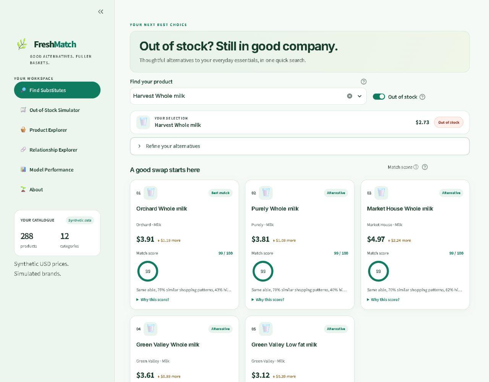
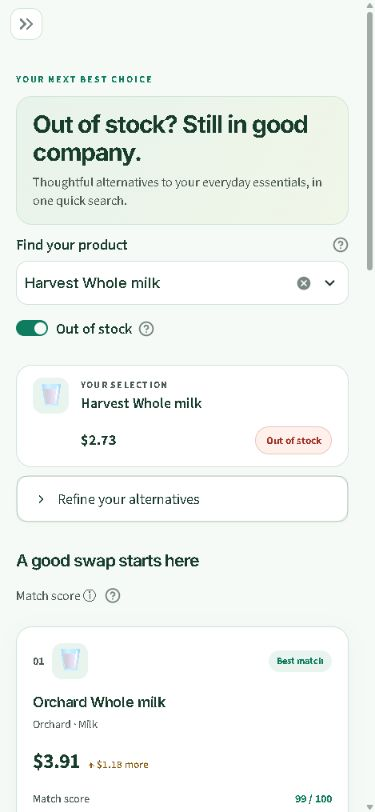
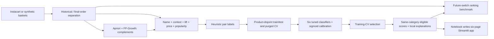
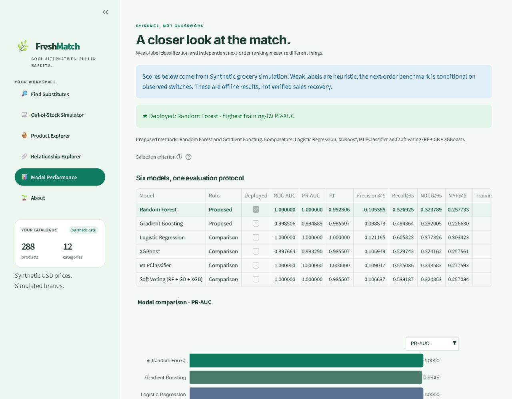

# FreshMatch

**An explainable grocery substitution workbench: smarter swaps, fuller baskets.**

[Open in Colab](https://colab.research.google.com/github/RangaMokshagna/FreshMatch/blob/main/product_substitution.ipynb) · [Notebook](product_substitution.ipynb) · [Measured results](RESULTS.md) · [Validation](VALIDATION.md) · [MIT License](LICENSE)

One executable notebook builds the dataset, mines complement relationships, tunes six classifiers, calibrates suitability scores, evaluates future switching, writes the complete Streamlit app with `%%writefile app.py`, and launches it. No separate Python source is needed.

## Experience

- **Find Substitutes:** compact search banner, searchable catalogue, availability controls, price/brand/category filters, ranked cards, animated score rings, price differences and CSV export.
- **Out-of-Stock Simulator:** multiple outages, available-only candidates, demand/acceptance assumptions and clearly labelled recovery KPI cards.
- **Product Explorer:** category search, popularity and price views.
- **Relationship Explorer:** Apriori/FP-Growth complements, context-based alternatives and interactive relationship graphs.
- **Model Performance:** identical six-model table and interactive metric chart, deployed winner, diagnostics, calibration Brier loss, global permutation importance and independent ranking baselines.
- **About:** methodology, limitations and team.

Mint background, brand green `#0F7B5F`, amber accents, Inter, 8px spacing tokens, white controls, visible keyboard focus, contrast-aware text, custom sidebar pills, skeleton loading and reduced-motion support. Cards use three columns on desktop and one on mobile. Each card includes a plain-English explanation and expandable model feature sensitivity.

Mobile preview at 375px

## Run in Google Colab

1. Click **Open in Colab** above and choose a Python CPU runtime.
2. Select **Runtime → Run all**. The first cell installs exact dependency versions.
3. Open the **PUBLIC APP URL** printed by the launcher. Keep the runtime alive while using the app.

No API key or uploaded data is required for synthetic mode. Package downloads and the temporary Cloudflare tunnel require network access. If the tunnel is unavailable, rerun only the launch cell; training results are cached. A Colab live run was not performed for this submission; the notebook was executed locally end to end.

### Local run

Use Python 3.11 (the verified environment). Create a virtual environment and install `python -m pip install -r requirements.txt`. Open `product_substitution.ipynb` in Jupyter or VS Code, select that environment, and run all cells. The launcher starts `http://localhost:8501`. After running the notebook, `python -m streamlit run app.py` reopens the generated app.

For automated runs set `FRESHMATCH_SKIP_LAUNCH=1`. The notebook remains the source of truth and writes `app.py`; the generated app and the small set of catalogue, score-matrix and evaluation artifacts it needs are tracked so Streamlit Community Cloud can deploy directly. Set the Cloud main file to `streamlit_app.py`. Model binaries, caches, private data and local Streamlit settings remain ignored by Git. Clear `.cache_freshmatch/` for a cold fit. Random seeds are fixed at **42**, while machine-dependent training times can vary.

## Data and scientific boundaries

The notebook checks `instacart/` (or `FRESHMATCH_DATA_DIR`) for original Instacart files, then configured Kaggle credentials, then falls back automatically to **288 products, 12 categories, six brands, 24,000 history baskets and 3,000 future baskets**. Set credentials outside notebook source and accept the [Instacart competition rules](https://www.kaggle.com/c/instacart-market-basket-analysis/data) yourself before downloading.

This measured run uses **synthetic data**. Synthetic prices and brands are simulated. Instacart prices are deterministic estimates and brands are unverified name-token proxies. The app and manifest identify the source. Never commit credentials, raw histories or generated model files.

## Architecture

**Complements are not substitutes.** Both mining algorithms use the same historical baskets, support 0.0015 and itemsets up to length two, and must agree. Substitution features combine same-category/aisle/department/brand, TF-IDF name cosine, co-purchase-context cosine, smoothed log lift, symmetric price/popularity ratios and reorder similarity. Eligible alternatives must share category, have lift below 1.5, fit filters and be available; self-matches and all declared outages are excluded.

**Supervised split:** both product endpoints are disjoint between training and testing. Pairs spanning a boundary are purged. All six models use exactly the same three product-disjoint CV folds. Historical context and weak-label thresholds are computed from available catalogue history: this is a **transductive** benchmark, not fully inductive cold start. Heuristic labels are not expert ground truth, and the high classification scores primarily show agreement with that heuristic.

**Models:** RF and GB remain the proposed methods. LR, XGBoost, scaled MLP and soft voting RF+GB+XGBoost are comparators. Brief 2–4-configuration searches use training-CV average precision. LR/MLP scaling stays inside fold pipelines; MLP's early stopping is internal to training folds. Calibration fits sigmoid calibrators on held-out product folds and averages calibrated models. Deployment uses training-CV PR-AUC only; values tied to 12 decimals retain declared model order. CV selection is non-nested and can be optimistic. [Calibration protocol reference](https://scikit-learn.org/stable/modules/generated/sklearn.calibration.CalibratedClassifierCV.html).

**Explanations:** global permutation importance measures held-out PR-AUC sensitivity. Each recommendation also compares its probability with each feature replaced by its training median, showing its two largest signed changes. These local occlusion sensitivities are model-based, non-additive, baseline-dependent and not causal effects or SHAP values. Scores describe weak-label suitability, not shopper acceptance, nutritional equivalence or dietary safety.

## Measured six-model results

Classification: **443 product-disjoint test pairs**. Rankings: **3,194 independently held-out household-query switching events**, with identical candidate pools. K=5. PR-AUC means average precision. MAP is truncated at five and normalized by all relevant targets; Recall@5 uses all observed relevant targets. Ranking results average over events, not unique product IDs.

| Model | ROC-AUC | PR-AUC | F1 | Precision@5 | Recall@5 | NDCG@5 | MAP@5 | Training time (s) |
| --- | --- | --- | --- | --- | --- | --- | --- | --- |
| Random Forest | 1.0000 | 1.0000 | 0.9928 | 0.1054 | 0.5269 | 0.3238 | 0.2577 | 8.6515 |
| Gradient Boosting | 0.9985 | 0.9949 | 0.9855 | 0.0989 | 0.4944 | 0.2920 | 0.2267 | 6.3029 |
| Logistic Regression | 1.0000 | 1.0000 | 1.0000 | 0.1212 | 0.6058 | 0.3778 | 0.3034 | 0.1559 |
| XGBoost | 0.9977 | 0.9933 | 0.9855 | 0.1059 | 0.5297 | 0.3242 | 0.2576 | 2.2667 |
| MLPClassifier | 1.0000 | 1.0000 | 1.0000 | 0.1090 | 0.5451 | 0.3436 | 0.2776 | 4.0440 |
| Soft Voting (RF + GB + XGB) | 1.0000 | 1.0000 | 0.9855 | 0.1066 | 0.5332 | 0.3249 | 0.2570 | 7.9429 |

**Deployed: Random Forest**, selected by training CV, with sigmoid-calibrated scores. LR has the strongest future ranking here; the reporting benchmark does not override the predeclared selection policy. Training time includes search, refit and calibration; ensemble timing includes component fits. Cache hits retain original measured times. The notebook and app consume the same comparison table; the chart dropdown keeps seconds separate from quality scores.

FreshMatch's conditional future-switch hit rate is **52.7%** (household-bootstrap 95% interval **51.0%–54.4%**), versus content **51.8%** and popularity **32.2%**. Content has better NDCG and MAP than deployed RF. Near-perfect weak-label classification and moderate behavioral ranking measure different tasks. We report both, without treating either as causal sales recovery.

The simulator uses covered demand × a user-controlled acceptance assumption, multiplied by alternative prices for the revenue scenario. It has no inventory-capacity model and does not establish actual lost sales or recovery.

## Reproducibility and validation

- End-to-end notebook execution completed locally with exact pinned dependencies; meaningful interactive chart outputs are retained.
- Product-disjoint outer/CV assertions, six recomputed test metrics, winner-derived score probabilities, category/lift eligibility and local explanations pass automated checks.
- All six pages render under Streamlit AppTest and browser inspection at **1280px desktop and 375px mobile**, with no page-width overflow or browser console errors. Wide comparison tables scroll internally.
- Checked example selection, detailed explanation expansion, CSV availability, loading states and the shared performance table. See [VALIDATION.md](VALIDATION.md) for scope and remaining limitations.

## Repository map

| File | Purpose |
| --- | --- |
| `product_substitution.ipynb` | Complete executable project, embedded app, chart outputs and launcher |
| `requirements.txt` | Exact tested dependency pins |
| `RESULTS.md` | Full measured tables generated by the notebook |
| `assets/` | Banner, actual desktop/mobile screenshots, comparison CSV and validation evidence |
| `PROJECT_REPORT.md` | Concise method and result report |
| `PRESENTATION_OUTLINE.md` | Viva / presentation talking points |
| `LICENSE` | MIT |

Generated data/models/caches, Jupyter checkpoints, `.env` files and Python runtime files are ignored. Regenerate them by running the notebook; never load untrusted joblib files.

## Team

| Member | Registration |
| --- | --- |
| K. Darshan Sai | RA2311027010002 |
| J. Ranga Mokshagna | RA2311027010003 |
| P. Bharat Sai | RA2311027010007 |

Built with Python, pandas, NumPy, SciPy, scikit-learn, XGBoost, mlxtend, Plotly and Streamlit. Licensed under MIT.
