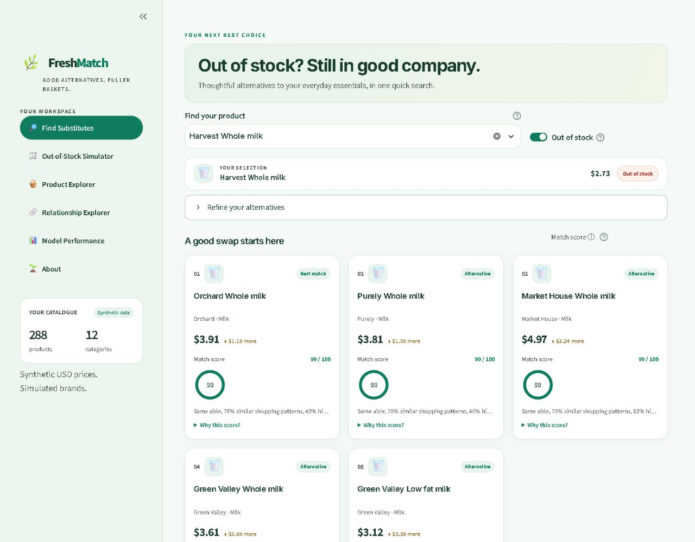
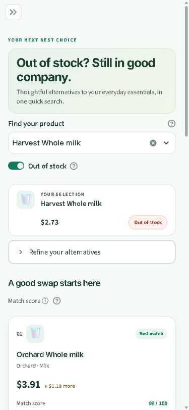
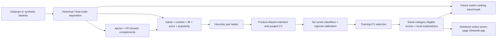
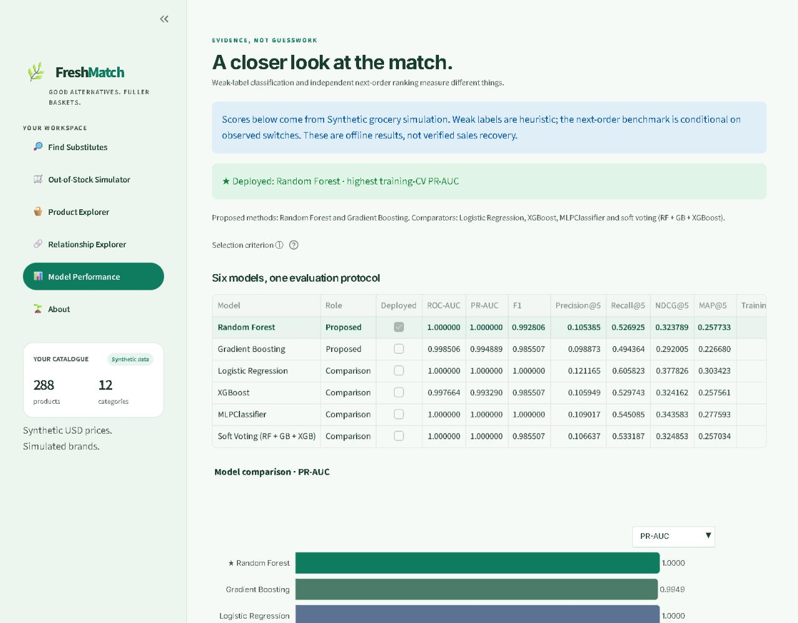

# FreshMatch

**An explainable grocery substitution workbench: smarter swaps, fuller baskets.**

[Open in Colab](https://colab.research.google.com/github/RangaMokshagna/FreshMatch/blob/main/product_substitution.ipynb) · [Notebook](product_substitution.ipynb) · [Measured results](RESULTS.md) · [Validation](VALIDATION.md) · [MIT License](LICENSE)

One executable notebook builds the dataset, mines complement relationships, tunes six classifiers, calibrates suitability scores, evaluates future switching, writes the complete Streamlit app and behavioral ranking module, and launches it. The notebook embeds the Python sources for self-contained Colab execution; editable Python files and automated tests also support local development.

## Experience

- **Find Substitutes:** compact search banner, searchable catalogue, availability controls, price/brand/category filters, ranked cards, animated score rings, price differences and CSV export.
- **Out-of-Stock Simulator:** multiple outages, available-only candidates, demand/acceptance assumptions and clearly labelled recovery KPI cards.
- **Product Explorer:** category search, popularity and price views.
- **Relationship Explorer:** Apriori/FP-Growth complements, context-based alternatives and interactive relationship graphs.
- **Model Performance:** identical six-model table and interactive metric chart, deployed winner, diagnostics, calibration Brier loss, global permutation importance and independent ranking baselines.
- **ML Lab:** behavioral LambdaMART, household-held-out ranking comparisons, paired confidence intervals, category slices, feature ablations, reliability diagrams and a filtered ranker demo.
- **About:** methodology, limitations and team.

Mint background, brand green `#0F7B5F`, amber accents, Inter, 8px spacing tokens, white controls, visible keyboard focus, contrast-aware text, custom sidebar pills, skeleton loading and reduced-motion support. Cards use three columns on desktop and one on mobile. Each card includes a plain-English explanation and expandable model feature sensitivity.



<details><summary>Mobile preview at 375px</summary>



</details>

## Run in Google Colab

1. Click **Open in Colab** above and choose a Python CPU runtime.
2. Select **Runtime → Run all**. The first cell installs exact dependency versions.
3. Open the **PUBLIC APP URL** printed by the launcher. Keep the runtime alive while using the app.

No API key or uploaded data is required for synthetic mode. Package downloads and the temporary Cloudflare tunnel require network access. If the tunnel is unavailable, rerun only the launch cell; training results are cached. A Colab live run was not performed for this submission; the notebook was executed locally end to end.

### Local run

**Windows laptop:** follow [WINDOWS_SETUP.md](WINDOWS_SETUP.md) to download this project, copy the CSVs from your Downloads folder, train, and start the app.

Use Python 3.11 (the verified environment). Create a virtual environment and install `python -m pip install -r requirements.txt`. Open `product_substitution.ipynb` in Jupyter or VS Code, select that environment, and run all cells. The launcher starts `http://localhost:8501`. After running the notebook, `python -m streamlit run app.py` reopens the generated app.

For automated runs set `FRESHMATCH_SKIP_LAUNCH=1`. The notebook remains the source of truth and writes `app.py`; the generated app and the small set of catalogue, score-matrix and evaluation artifacts it needs are tracked so Streamlit Community Cloud can deploy directly. Set the Cloud main file to `streamlit_app.py`. Model binaries, caches, private data and local Streamlit settings remain ignored by Git. Clear `.cache_freshmatch/` for a cold fit. Random seeds are fixed at **42**, while machine-dependent training times can vary.

## Advanced ML workflow

```bash
python -m venv .venv
source .venv/bin/activate
python -m pip install -r requirements.txt
python scripts/train.py --data-source instacart --data-dir ./instacart
python -m unittest discover -s tests -v
python -m streamlit run streamlit_app.py --server.headless=true --browser.gatherUsageStats=false
```

The runner verifies exact dependencies, executes the notebook without package reinstallation or a public tunnel, and saves the executed notebook under `.cache_freshmatch/`. Training intentionally regenerates `app.py`, inference artifacts and `RESULTS.md`. To edit Python sources, run `python scripts/sync_notebook.py` before training; the synchronization test prevents drift between Python and notebook implementations. Python 3.12 is validated alongside the earlier documented Python 3.11 run. CI runs training and tests on Python 3.12.

**Behavioral LambdaMART** (`XGBRanker`, `rank:ndcg`) learns from observed historical adjacent-order switches rather than the heuristic pair labels. A seeded household split assigns 70% to training, 15% to validation and 15% to testing. Training uses historical transitions only. Four tree configurations compete on validation-household final-order NDCG@5; the selected configuration is fixed for test evaluation. Three feature-removal studies use validation only. The original six-model weak-label experiment remains available for comparison.

**Previous synthetic demonstration (not real-data results):** 474 final-order events from 278 households. LambdaMART reaches **NDCG@5 0.4067** and **64.1% hit rate**, versus **0.3580** and **56.5%** for the weak-label classifier on exactly those events. The paired NDCG difference is **+0.0488**, with a 95% household-bootstrap interval **[+0.0102, +0.0865]**. Content, shopping-context and popularity baselines use identical candidate pools. These subset results differ from the original 3,194-event benchmark and must not be compared as though the populations were identical.

Open **ML Lab** to explore the results, category sample counts, validation ablations, ranker gain importance and classifier reliability diagrams (Brier loss, log loss and equal-width-bin ECE). The ranker demo respects price and availability filters. Its relative scores are not probabilities. The main recommendation cards continue to use calibrated weak-label suitability; the experimental ranker is presented separately for comparison.

Catalogue features use all historical households, so the evaluation is **transductive**, even though training, validation and test households are disjoint. Final orders never fit features. Observed switches are proxy relevance, synthetic need IDs define relevance but are excluded from model features, and none of these results establishes real stockout recovery or shopper acceptance. Feature ablations can improve validation performance; they are reported without using test scores to change the selected model.

Artifacts: `artifacts/advanced_report.json`, `advanced_scores.npz` and `advanced_test_events.csv` are portable inference/audit outputs. The fitted `behavioral_ranker.ubj` remains local and can be regenerated. The app uses safe numeric arrays and JSON, without unpickling a ranker.

### Use the real Instacart dataset

1. Open the [official Kaggle download page](https://www.kaggle.com/c/instacart-market-basket-analysis/data), sign in, and accept the competition rules.
2. Download the dataset. Extract it locally, or let the helper extract the official ZIP (including nested `*.csv.zip` files):

```bash
python scripts/prepare_instacart.py /path/to/instacart-market-basket-analysis.zip --output ./instacart
```

The directory must contain `orders.csv`, `order_products__prior.csv`, `products.csv`, `aisles.csv` and `departments.csv`. Extra Instacart files are not required. Alternatively, point directly to an existing extracted directory. Never commit the raw files or Kaggle credentials.

3. Check input schemas and sample rows, then train:

```bash
python scripts/train.py --data-source instacart --data-dir ./instacart --check-data
python scripts/train.py --data-source instacart --data-dir ./instacart
python -m unittest discover -s tests -v
python -m streamlit run streamlit_app.py
```

The check-only command does not fit models or replace artifacts. Training performs additional full checks on catalogue/lookup identifiers and sampled purchase records. It streams the large prior CSV, samples up to 3,000 eligible households and selects up to 320 products by historical frequency. Each household's final available **prior** order is held out; this does not claim to evaluate Kaggle's hidden competition test labels. Larger runs require a separate resource/evaluation plan.

All five CSV content hashes, sampling settings and field provenance are saved in `artifacts/manifest.json`; any changed source file invalidates the ingestion cache. The app identifies the resulting source as Instacart only after artifacts are regenerated. Prices remain deterministic estimates and brand strings remain unverified name-token proxies. Real aisle-level switching relevance is broader than the synthetic hidden-need relevance, so the two datasets' scores are not directly comparable.

**Pending:** real-data model performance has not been measured in this environment; the official files have not been supplied. Existing metrics, reports and screenshots describe the previous synthetic run. Once files are supplied, rerun training and review real-data suitability/ranking results before replacing those claims.

For explicit demo/CI execution only:

```bash
python scripts/train.py --data-source synthetic
```

In a notebook set `FRESHMATCH_DATA_DIR` before the data cell; `FRESHMATCH_DATA_SOURCE` defaults to `instacart`. To intentionally run a demo, set `FRESHMATCH_DATA_SOURCE=synthetic`. The notebook embeds `real_data.py` so Colab requires no separately uploaded Python module.

## Data and scientific boundaries

Real Instacart data is now required by default. Missing or invalid input stops training before inference artifacts are changed; there is no automatic synthetic fallback. The existing checked-in artifacts are still the previous synthetic demo until a real-data run completes. The app displays a prominent synthetic-data notice while those artifacts remain loaded.

This measured run uses **synthetic data**. Synthetic prices and brands are simulated. Instacart prices are deterministic estimates and brands are unverified name-token proxies. The app and manifest identify the source. Never commit credentials, raw histories or generated model files.

## Architecture



**Complements are not substitutes.** Both mining algorithms use the same historical baskets, support 0.0015 and itemsets up to length two, and must agree. Substitution features combine same-category/aisle/department/brand, TF-IDF name cosine, co-purchase-context cosine, smoothed log lift, symmetric price/popularity ratios and reorder similarity. Eligible alternatives must share category, have lift below 1.5, fit filters and be available; self-matches and all declared outages are excluded.

**Supervised split:** both product endpoints are disjoint between training and testing. Pairs spanning a boundary are purged. All six models use exactly the same three product-disjoint CV folds. Historical context and weak-label thresholds are computed from available catalogue history: this is a **transductive** benchmark, not fully inductive cold start. Heuristic labels are not expert ground truth, and the high classification scores primarily show agreement with that heuristic.

**Models:** RF and GB remain the proposed methods. LR, XGBoost, scaled MLP and soft voting RF+GB+XGBoost are comparators. Brief 2–4-configuration searches use training-CV average precision. LR/MLP scaling stays inside fold pipelines; MLP's early stopping is internal to training folds. Calibration fits sigmoid calibrators on held-out product folds and averages calibrated models. Deployment uses training-CV PR-AUC only; values tied to 12 decimals retain declared model order. CV selection is non-nested and can be optimistic. [Calibration protocol reference](https://scikit-learn.org/stable/modules/generated/sklearn.calibration.CalibratedClassifierCV.html).

**Explanations:** global permutation importance measures held-out PR-AUC sensitivity. Each recommendation also compares its probability with each feature replaced by its training median, showing its two largest signed changes. These local occlusion sensitivities are model-based, non-additive, baseline-dependent and not causal effects or SHAP values. Scores describe weak-label suitability, not shopper acceptance, nutritional equivalence or dietary safety.

## Measured six-model results

Classification: **443 product-disjoint test pairs**. Rankings: **3,194 independently held-out household-query switching events**, with identical candidate pools. K=5. PR-AUC means average precision. MAP is truncated at five and normalized by all relevant targets; Recall@5 uses all observed relevant targets. Ranking results average over events, not unique product IDs.

| Model | ROC-AUC | PR-AUC | F1 | Precision@5 | Recall@5 | NDCG@5 | MAP@5 | Training time (s) |
| --- | --- | --- | --- | --- | --- | --- | --- | --- |
| Random Forest | 1.0000 | 1.0000 | 0.9928 | 0.1054 | 0.5269 | 0.3238 | 0.2577 | 3.4402 |
| Gradient Boosting | 0.9985 | 0.9949 | 0.9855 | 0.0989 | 0.4944 | 0.2920 | 0.2267 | 2.9571 |
| Logistic Regression | 1.0000 | 1.0000 | 1.0000 | 0.1212 | 0.6058 | 0.3778 | 0.3034 | 0.0981 |
| XGBoost | 0.9978 | 0.9935 | 0.9855 | 0.1093 | 0.5466 | 0.3280 | 0.2572 | 0.2734 |
| MLPClassifier | 1.0000 | 1.0000 | 1.0000 | 0.1090 | 0.5451 | 0.3436 | 0.2776 | 1.3460 |
| Soft Voting (RF + GB + XGB) | 1.0000 | 1.0000 | 0.9855 | 0.1066 | 0.5332 | 0.3260 | 0.2586 | 3.7266 |

**Deployed: Random Forest**, selected by training CV, with sigmoid-calibrated scores. LR has the strongest future ranking here; the reporting benchmark does not override the predeclared selection policy. Training time includes search, refit and calibration; ensemble timing includes component fits. Cache hits retain original measured times. The notebook and app consume the same comparison table; the chart dropdown keeps seconds separate from quality scores.

FreshMatch's conditional future-switch hit rate is **52.7%** (household-bootstrap 95% interval **51.0%–54.4%**), versus content **51.8%** and popularity **32.2%**. Content has better NDCG and MAP than deployed RF. Near-perfect weak-label classification and moderate behavioral ranking measure different tasks. We report both, without treating either as causal sales recovery.

The simulator uses covered demand × a user-controlled acceptance assumption, multiplied by alternative prices for the revenue scenario. It has no inventory-capacity model and does not establish actual lost sales or recovery.



## Reproducibility and validation

- End-to-end notebook execution completed locally with exact pinned dependencies; interactive charts are generated during execution. The source notebook has cleared outputs; the local runner saves an executed copy in `.cache_freshmatch/executed.ipynb`.
- Product-disjoint outer/CV assertions, six recomputed test metrics, winner-derived score probabilities, category/lift eligibility and local explanations pass automated checks.
- The original six pages were checked with Streamlit AppTest and browser inspection at **1280px desktop and 375px mobile**, with no page-width overflow or browser console errors. Wide comparison tables scroll internally.
- Checked example selection, detailed explanation expansion, CSV availability, loading states and the shared performance table. See [VALIDATION.md](VALIDATION.md) for scope and remaining limitations.

## Repository map

| File | Purpose |
| --- | --- |
| `product_substitution.ipynb` | Complete executable project, embedded app, chart outputs and launcher |
| `real_data.py` | Strict real-data validation, streaming ingestion, provenance and safe archive extraction |
| `advanced_ml.py` | Behavioral ranking, clustered uncertainty and calibration diagnostics |
| `scripts/` | Notebook training and Python/notebook synchronization |
| `tests/` | Metric, split, artifact and seven-page app tests |
| `requirements.txt` | Exact tested dependency pins |
| `RESULTS.md` | Full measured tables generated by the notebook |
| `assets/` | Banner, actual desktop/mobile screenshots, comparison CSV and validation evidence |
| `PROJECT_REPORT.md` | Concise method and result report |
| `PRESENTATION_OUTLINE.md` | Viva / presentation talking points |
| `LICENSE` | MIT |

Generated data/models/caches, Jupyter checkpoints, `.env` files and Python runtime files are ignored. Regenerate them by running the notebook; never load untrusted joblib files.

## Team

| Member | Registration |
| --- | --- |
| K. Darshan Sai | RA2311027010002 |
| J. Ranga Mokshagna | RA2311027010003 |
| P. Bharat Sai | RA2311027010007 |

Built with Python, pandas, NumPy, SciPy, scikit-learn, XGBoost, mlxtend, Plotly and Streamlit. Licensed under MIT.
